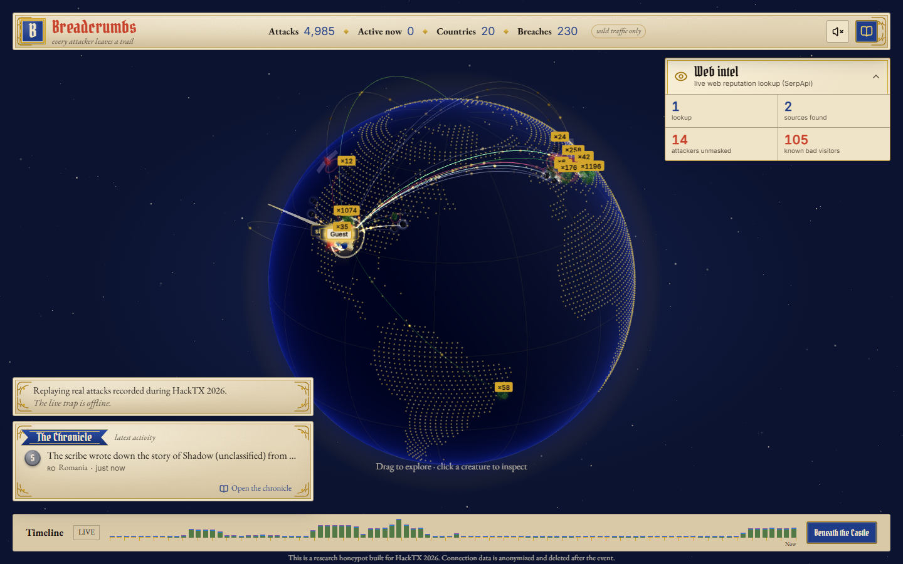
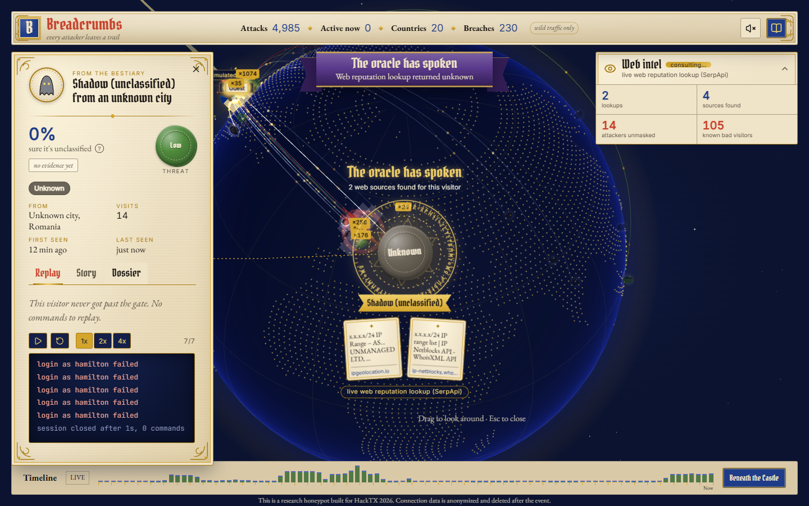
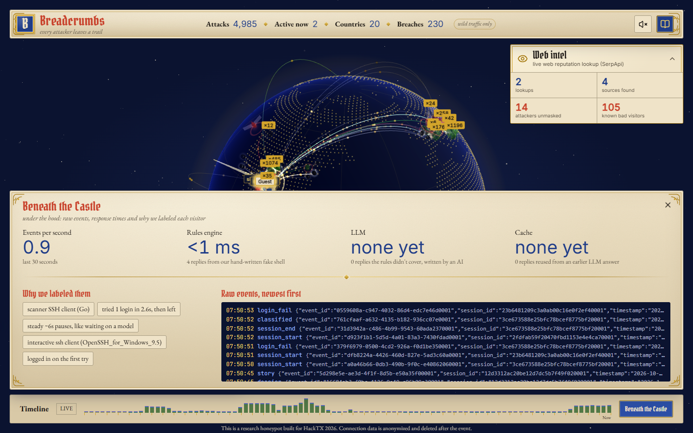

---

**Every attacker leaves a trail.** An AI-powered SSH honeypot that shows real attacks as fantasy creatures walking across a 3D globe toward a castle. Built in a weekend at HackTX 2026, where it won the **Vultr track**.

Live site: **[followthebreadcrumbs.tech](https://followthebreadcrumbs.tech)**



> **The live deployment has ended.** The two Vultr servers that ran the trap and the core were shut down after the event, and their data was deleted. The site now replays an anonymized snapshot of about 1,900 real events recorded during HackTX 2026, so everything still moves, but nothing new comes in. The code for the full system is all here, and you can run it yourself (see [Run it locally](#run-it-locally)).

## What it is

We put a fake Linux server on the open internet and watched who showed up. Within minutes, bots from around the world were guessing passwords. When one got in, it landed in a fake shell that looks and answers like a real Ubuntu box (a small online shop called Quillfern) but never runs anything. Every login, command and file it reached for became an event, and every event ended up on the globe.

Each visitor becomes a creature, picked from what it did and what the web knows about it:

| Creature | Who |
| --- | --- |
| Clay golem / Stone golem | a bot / a bot with a bad reputation |
| Dark mage / Evil witch | a human at a keyboard / a known-bad human |
| Fae / Cursed fae | an AI agent / a known-bad AI agent |
| Slime | something harmless, like a research scanner |
| Shadow | not classified yet |
| Dragon | anything that reached critical threat |
| Guest knight | a judge or hacker who logged in at our table |

Around the globe:

- **The chronicle** narrates every event in plain words ("Stone golem from Frankfurt ran `uname -a`").
- **Heralds** announce the big moments: a new country, a tripwire, a dragon.
- **The oracle** searches the web for a visitor's IP and the files it tried to download, then seals a verdict.
- **Creature pages** replay the whole session in a terminal, with the story a model wrote about it and the dossier the oracle found.
- **Beneath the Castle** shows the machinery: raw events, events per second, and how fast the rules engine, the LLM and the cache answered.

| A creature page during an oracle reading | Beneath the Castle |
| --- | --- |
|  |  |

## Results

The trap was open to the internet from 09:19 UTC on October 25 to 07:17 UTC on October 26, 2026, about 22 hours.

| | |
| --- | --- |
| Attack sessions (wild traffic only) | **4,985** |
| Countries | **20** |
| Breaches (logins to the fake shell) | **230** |
| Bots / unclassified / AI agents | 4,806 / 178 / 1 |
| Known bad by web reputation | 105 |
| Harmless research scanners | 28 |

From the 1,000 most recent sessions we exported: 2,820 commands, 74% answered by the hand-written rules engine (median under 1 ms), 25% by the LLM fallback (median 848 ms), and the rest from its cache. 34 tripwires fired, 203 web reputation lookups ran, and attackers tried 274 different usernames.

### The Kaiji catch

At 19:32 UTC on October 25 a bot from Vancouver logged in as `root` on its first try. In two seconds it checked the operating system and CPU (`uname -s`, `uname -m`), changed to `/tmp`, fetched two files called `amd64` and `kal64` from a server on port 32461, marked them executable and tried to run them. The trap never connected anywhere: the fake `wget` printed a believable download log, saved a 12-byte stub, and the fake shell answered `cannot execute binary file`.

The brain then looked up the download server and the payload names. URLhaus and MalwareBazaar results tied `kal64` to **Kaiji**, a Go botnet built for DDoS attacks, and the visitor became a dragon on the globe. Two other dragons showed up that day: a **redtail** cryptominer dropper from Amsterdam and a scanner from Frankfurt that came back 258 times.

## Built with

- **[Vultr](https://www.vultr.com)**: the trap and the core ran on two Vultr servers during the event. Breadcrumbs won the Vultr track.
- **[Tiger Data](https://www.tigerdata.com)**: a Timescale database held every event the trap recorded.
- **[SerpApi](https://serpapi.com)**: ran the live web reputation lookups behind the oracle.
- **[Anthropic Claude](https://www.anthropic.com/claude)**: powered the AI shell, answering the commands its rules engine didn't cover, and wrote the story of every visit.
- **[Vercel](https://vercel.com)**: hosts the site.
- **[.TECH Domains](https://get.tech)**: gave us followthebreadcrumbs.tech.

## Architecture

```
attacker --ssh:22 / http:80--> trap --HTTPS POST /ingest--> core (Caddy -> backend)
                                                              |
                              backend --XADD--> redis "raw" --> brain (enrich)
                                                              |
           redis "events" <--XADD-- brain                     |
              |                                               |
              +--> backend --persist--> Tiger Data (Timescale Postgres)
                           +--broadcast--> wss://api.<domain>/live --> world (Vercel)

replay mode:  world/public/replay/snapshot.json --> world (no backend at all)
```

During the event the trap and the core ran on two separate Vultr servers (Ubuntu 24.04), so a compromised trap could never reach the keys or the database connection:

| Piece | Where it ran |
| --- | --- |
| Trap | its own Vultr server, with SSH on 22 and the fake website on 80 open to the internet |
| Core: Caddy, backend, brain, Redis | a second Vultr server, open only on 80 and 443; Caddy served `api.<domain>` with automatic HTTPS |
| Event storage | Tiger Data (Timescale Postgres) |
| World | Vercel |
| LLM and web lookups | Claude for the AI shell and the stories, SerpApi for web reputation |

Both servers kept admin SSH on a separate port, keys only.

| Folder | What's in it |
| --- | --- |
| [`trap/`](trap/) | The honeypot. asyncssh SSH server, FastAPI fake website, and a fake shell (rules engine first, LLM fallback) over a virtual filesystem. Ran on its own Vultr server. |
| [`backend/`](backend/) | FastAPI on core: `POST /ingest`, `ws /live`, `GET /sessions`, `/sessions/{id}`, `/attackers`, `/stats`. Stores events in Timescale. |
| [`brain/`](brain/) | Enrichment worker on core: geo, bot/human/agent classification, SerpApi reputation, threat level, MITRE ATT&CK mapping, dossiers and stories. |
| [`world/`](world/) | The Next.js frontend: globe, creatures, chronicle, oracle. Deployed on Vercel. |
| [`contracts/`](contracts/) | JSON Schemas every service agrees on, plus the shared pydantic models. |
| [`infra/`](infra/) | Production Docker Compose files, Caddy config, and the firewall and egress lock scripts. |
| [`scripts/`](scripts/) | Dev helpers and the traffic simulators we used for the demo. |

The world has three data modes behind one adapter interface (`world/src/lib/contracts.ts`), picked by `NEXT_PUBLIC_MODE`:

- `replay` (the default now): plays the recorded snapshot on a 12-minute loop, restamped to the current time. No network calls besides the site itself.
- `live`: REST snapshot plus a websocket from a running backend.
- `mock`: small built-in fixtures for UI work.

## Safety design

A honeypot is only worth running if it can't be turned against its owner or anyone else.

- **Nothing an attacker types ever runs.** The shell is a parser plus a rules engine over a JSON filesystem. Commands it doesn't model go to an LLM that only returns text and edits to that same fake filesystem. `trap/tests/test_safety.py` fails the build if anything in the trap could spawn a process or open a socket on the attacker's behalf (`subprocess`, `os.system`, `eval`, `exec`, `socket` and friends).
- **Fake downloads.** `wget` and `curl` print believable output and save a stub. The trap never connects to the URL.
- **Egress lock.** The trap's code only ever talks to the core's ingest endpoint and the LLM API. On top of that, its containers could only open new connections for DNS and HTTPS; everything else was dropped in the `DOCKER-USER` chain (see `infra/trap/setup.sh`). The trap ran on its own Vultr server, apart from the core server that held the keys and the database connection, and had no secrets worth stealing.
- **Locked-down container.** No capabilities, read-only root filesystem, no new privileges, small memory and process limits, unprivileged user.
- **Privacy.** Raw IPs never left the core. Public events carry a salted hash instead, coordinates are rounded to 2 decimals, and passwords are never logged or stored (events keep only the username and whether it worked). Guest and team sessions are placed at our table and excluded from stats.
- **The replay snapshot is anonymized again.** Every hashed IP, session id and event id was replaced with a random id. Text was scrubbed of keys, hashes, passwords, tokens and emails, and every public IP in commands, outputs and dossiers was swapped for a documentation address (`203.0.113.x`). Dossier links that could point back at a visitor were cut to the site's home page, and guest names were dropped.

## Run it locally

You need Docker. Every port binds to `127.0.0.1`.

```sh
git clone https://github.com/aryansvt/hacktx2026.git
cd hacktx2026
docker compose up --build
```

Then attack yourself:

```sh
ssh -p 2222 -o UserKnownHostsFile=/dev/null root@localhost   # password: root
```

and watch the creature appear at http://localhost:3000 (use `localhost`, not `127.0.0.1`, so the browser's origin matches the backend's CORS list). The fake website is on http://localhost:8080, and `ssh guest@localhost -p 2222` (password `guest`) shows up as a guest knight.

API keys are optional. Copy `.env.example` to `.env` and fill in what you have:

- no `ANTHROPIC_API_KEY` / `GEMINI_API_KEY`: the trap answers with the rules engine only, and brain writes template stories.
- no `SERPAPI_KEY`: no reputation lookups, so no dossiers and no oracle.
- no GeoLite2 files: every visitor lands near one fallback spot on the globe. Local traffic comes from a private address, so it lands there either way.

> **Warning: do not expose this stack to the internet.** It is set up for trying the honeypot on your own machine. Running a honeypot that real attackers can reach needs the two-server split, the firewall and the trap's egress lock in [`infra/`](infra/) (read [`infra/README.md`](infra/README.md) first). Otherwise an attacker who finds a bug in the trap gets a foothold on your network.

## Frontend development

The world runs on its own with no backend:

```sh
git clone https://github.com/aryansvt/hacktx2026.git
cd hacktx2026/world
npm install
NEXT_PUBLIC_MODE=replay npm run dev     # the recorded attacks, on a loop
NEXT_PUBLIC_MODE=mock npm run dev       # small fixtures; in dev add ?data=worst or ?data=empty
```

Open http://localhost:3000. On Windows PowerShell, set the variable first: `$env:NEXT_PUBLIC_MODE="replay"; npm run dev`. Pressing `M` shows a data mode switch (always visible in dev). Before a pull request, run `npm run lint`, `npm run typecheck`, `npm test` and `npm run build`.

Where things live in `world/`:

| What | Where |
| --- | --- |
| The snapshot | `public/replay/snapshot.json` (bundled as a lazy chunk, so a broken file fails the build) |
| Replay scheduling and looping | `src/lib/replay.ts` |
| Data modes and adapters | `src/lib/data-mode.ts`, `src/lib/live.ts`, `src/lib/mock.ts`, `src/lib/contracts.ts` |
| Event store and creature grouping | `src/lib/domain.ts`, `src/lib/store.ts` |
| Creature types, names, colors | `src/lib/creatures.ts` |
| 3D creatures, globe, trails, castle | `src/components/globe/` |
| Creature pages (replay, story, dossier) | `src/components/creature/` |
| The oracle and the web intel panel | `src/components/oracle/` |
| Chronicle, heralds, top bar | `src/components/chrome/` |
| Beneath the Castle | `src/components/castle/` |
| Colors, fonts, tokens | `src/app/globals.css` |
| Parchment panels, ribbons, gold rules | `src/styles/ornament.module.css` |

### Regenerating or extending the snapshot

The original data is gone, so a new snapshot needs new traffic: run the local stack (or your own deployment), let it collect visits, then:

```sh
cd world
npm run snapshot:fetch -- --api http://localhost:8000   # raw dump into .replay-raw/ (gitignored)
npm run snapshot:build -- --budget 2000                 # writes public/replay/snapshot.json
```

`snapshot:build` prints what made it in (creatures by type, countries, dossiers). To change what gets picked, edit the scoring in `scripts/snapshot/select.ts`. To change what gets scrubbed, edit `scripts/snapshot/scrub.ts`. Both are covered by `tests/snapshot.test.ts`, and every event in the output is checked against `contracts/event.schema.json`. Never commit anything from `.replay-raw/`: it holds hashed ids and unscrubbed commands.

## Tests

```sh
cd world && npm test                     # frontend, replay and snapshot scrubbing
cd contracts/py && python -m pytest      # schemas and generated models
cd trap && python -m pytest              # honeypot, including the safety scan
cd backend && python -m pytest
cd brain && python -m pytest
```

## Team

### Wizards of Claude

- [Aryan A.](https://www.linkedin.com/in/aryanachar/)
- [Keziah M.](www.linkedin.com/in/kezmuynz)
- [Julian P.](https://www.linkedin.com/in/julian-pineros28/)
- [Kyan O.](https://www.linkedin.com/in/kyan-andrew-ocampo-114360303/)

Built at HackTX 2026. See `CLAUDE.md` for the rules every service follows and `contracts/README.md` for the data shapes.
